<div align="center">

<picture>
  <source media="(prefers-color-scheme: dark)" srcset=".github/assets/banner-dark.svg">
  
</picture>

**Voice and video calls from PHP, with every frame staying native.**<br>
Native WebRTC peer connections, GPU video rendering and call audio routing for PAM Native applications.

[](https://packagist.org/packages/pushinbr/pam-native-webrtc)

[](LICENSE)

[Install](#install) · [Quick example](#quick-example) · [Platforms](#platform-support) · [Permissions](#requirements) · [Guide](docs/guide.md) · [Issues](https://github.com/push-in/pam-native-webrtc/issues)

</div>

<a id="install"></a>
## <picture></picture> Install

Inside a PAM Native project, add only this capability:

```sh
pam composer require pushinbr/pam-native-webrtc
pam doctor --fix
```

The package is a PAM Native plugin discovered from Composer; nothing is added to `pam-native.json`. It requires `pushinbr/pam-native` `>=1.0.35 <2.0.0` and PHP 8.5. The PHP provider registers the `<RtcVideoView>` template tag.

New to PAM? Create a project with `pam init my-app --template native` (see the [PAM Native overview](https://push-in.github.io/pam-docs/native/overview/)).

<a id="quick-example"></a>
## <picture></picture> Quick example

```php
use Pam\Native\WebRtc\{IceCandidate, IceServer, PeerConnection, SessionDescription};

$pc = PeerConnection::create([IceServer::stun('stun:stun.l.google.com:19302')])
    ->video()
    ->onIceCandidate(fn (IceCandidate $c) => $signaling->send('ice', $c->toArray()));

$pc->startLocal(function (bool $ok, string $error) use ($pc, $signaling): void {
    $pc->offer(fn (?SessionDescription $offer) => $signaling->send('offer', $offer?->toArray()));
});
```

PHP drives the call (signalling, state, UI); the platform WebRTC stack moves the media. Session descriptions and ICE candidates cross the bridge as small typed values, events are pushed through one pending module completion per session (no polling, no timers), and video frames are drawn natively into the view tree without ever reaching PHP.

The full walk-through (peer connection, group calls with `LocalMedia`, `RtcVideoView`, `CallAudio`, the event contract, a real app example) and the API reference are in [docs/guide.md](docs/guide.md).

<a id="platform-support"></a>
## <picture></picture> Platform support

| Platform | Support | Notes |
| --- | --- | --- |
| Android | API 26+ | WebRTC M124 (`org.jitsi:webrtc` 124.0.0) |
| iOS | 15.0+ | GoogleWebRTC M124 (`stasel/WebRTC` Swift package); not validated on a device yet |
| PAM Native | 1.0.35 to < 2.0.0 | From `pam-native.plugin.json`; PHP 8.5+ |

<a id="requirements"></a>
## <picture></picture> Permissions and requirements

| Platform | Declared by the plugin |
| --- | --- |
| Android | `INTERNET`, `ACCESS_NETWORK_STATE`, `CAMERA`, `RECORD_AUDIO`, `MODIFY_AUDIO_SETTINGS`, `WAKE_LOCK`, `VIBRATE`, and `BLUETOOTH` (`maxSdkVersion="30"`, for SCO routing on Android 11 and older). Camera and microphone are optional features (`android:required="false"`). |
| iOS | `NSCameraUsageDescription` ("Capture photos and videos."), `NSMicrophoneUsageDescription` ("Record audio with videos."), `UIBackgroundModes`: `audio` (`ios/Info.plist`) so calls keep running in the background. Frameworks `AVFoundation`, `AudioToolbox`. |

Request `PermissionKind::Microphone` (and `PermissionKind::Camera` for video) with the core `Permissions` API **before** `startLocal()`.

- Android dependency `org.jitsi:webrtc:124.0.0` adds native libraries for each ABI; expect a few MB per ABI in the APK.
- The iOS camera and microphone strings are identical to `pam-native-media`/`pam-native-camera` on purpose: the CLI fails the Info.plist merge when two plugins declare different values for the same key.
- For incoming calls on iOS use `pushinbr/pam-native-calls` (CallKit). Apps cannot play the user's system ringtone; `CallAudio::ringtone()` plays an alert sound with vibration instead. With CallKit, start `CallAudio` after CallKit activates the audio session (`Notification.Name.pamCallAudioActivated`).

<a id="what-you-can-build"></a>
## <picture></picture> What you can build

- **Peer connections**: offer/answer, trickle ICE, STUN/TURN, ICE restart, relay-only policy, microphone and camera toggles, camera switching, stats and any number of concurrent sessions.
- **Group calls**: `LocalMedia` opens one microphone and one camera and adds the same tracks to every peer of a mesh; mute, camera and front/back switch apply to all peers, peers join and leave freely and one preview renders it.
- **Native video**: `RtcVideoView` renders local and remote tracks (EGL `TextureView` on Android, Metal `RTCMTLVideoView` on iOS), composes with declarative overlays and rebinds by itself when tracks change.
- **Call audio**: `CallAudio` replaces `react-native-incall-manager`: communication audio focus and mode, speaker/earpiece, wired and Bluetooth routing with route events, ringback, ringtone with vibration, microphone mute and the proximity screen-off.

| | |
| --- | --- |
| **Best for** | 1:1 and small-group (mesh) voice and video calls, support video chat, telemedicine, walkie-talkie |
| **Application model** | Composer package + generated native integration (`webrtc` and `call-audio` modules, `webrtc.video` view) |
| **Design rule** | Media and audio routing only; signalling, TURN credentials and the call UI belong to your app |

<a id="troubleshooting"></a>
## <picture></picture> Limits and troubleshooting

- **`startLocal()` fails with a camera error:** the camera permission was not granted, or another app holds the camera.
- **No audio on Bluetooth (Android 12+):** routing uses `setCommunicationDevice`; the headset must be connected and support calls (SCO/LE). Call `bluetooth(false)` to force built-in outputs.
- **Connection stays `Connecting` on mobile networks:** add a TURN server; test with `relayOnly()` and check `RtcStats::$relayed`.
- **Video view is black:** render `RtcVideoView` with an explicit size (or absolute fill); the session id must match the `PeerConnection` id.
- **Two plugins conflict on iOS camera strings:** keep this package's strings or align the other plugin; the generated Info.plist rejects conflicting values.
- **Second peer of a group call fails with a camera error:** each peer opened its own capture; configure them with `localMedia($media)`.
- **iOS validation:** the iOS implementation was parse-checked and mirrors the Android suite (`ios/Tests/WebRtcTests.swift`) but has not been validated on a device yet.

<a id="compatibility"></a>
## <picture></picture> Compatibility

| `pushinbr/pam-native-webrtc` | `pushinbr/pam-native` | Android | iOS |
| --- | --- | --- | --- |
| 0.3.0 | `>=1.0.35 <2.0.0` (tested with 1.14.x) | API 26+, WebRTC M124 | 15+, GoogleWebRTC M124 |
| 0.2.1 | `>=1.0.35 <2.0.0` (tested with 1.14.x) | API 26+, WebRTC M124 | 15+, GoogleWebRTC M124 |
| 0.2.0 | `>=1.0.35 <2.0.0` | API 26+ | 15+ (Info.plist strings conflict with `pam-native-media`) |
| 0.1.x | `>=1.0.35 <2.0.0` | API 26+ | Not supported |

Tests: `pam tests/run.php` runs the PHP contracts; the instrumented Android suite runs a real loopback call. Details in [docs/guide.md#tests](docs/guide.md#tests).

<a id="docs"></a>
## <picture></picture> Docs

- [Guide and API reference](docs/guide.md)
- [Peer connection](docs/guide.md#peer-connection)
- [Group calls](docs/guide.md#group-calls-shared-local-media)
- [Call audio](docs/guide.md#call-audio)
- [Example app](example/)
- [PAM Native overview](https://push-in.github.io/pam-docs/native/overview/)
- [Changelog](CHANGELOG.md)
- [Report an issue](https://github.com/push-in/pam-native-webrtc/issues)

<a id="pam-ecosystem"></a>
## <picture></picture> Part of the PAM ecosystem

PAM runs PHP natively on servers, desktops and phones. This repository is one piece of it.

| [**PAM**](https://github.com/push-in/pam) | [**PAM Desktop**](https://github.com/push-in/pam-desktop) | [**PAM Native**](https://github.com/push-in/pam-native) | [**Ecosystem**](https://github.com/push-in/pam#ecosystem) |
| --- | --- | --- | --- |
| the runtime and CLI | native desktop apps in PHP | native Android and iOS apps in PHP | every official package and plugin |

<sub>Docs: [push-in.github.io/pam-docs](https://push-in.github.io/pam-docs/introduction/) · [Issues](https://github.com/push-in/pam-native-webrtc/issues)</sub>

<p align="center"><sub><a href="LICENSE">Apache License 2.0</a> · Made in Brazil by Pushin</sub></p>
